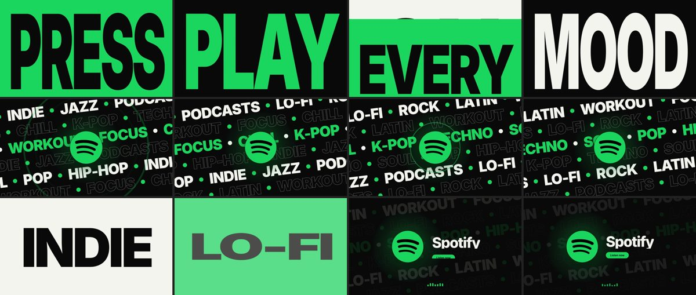

# Motion Design Director

**A Claude Code skill that turns product photos, a logo and a one-line style brief into a finished, art-directed motion-graphics video (MP4).**

You hand over images and a vibe. The skill does the rest:
- It reads the brief.
- It inspects the images (palette, background, cutouts).
- It searches the [motionprompts.dev](https://motionprompts.dev/) animation library for fitting mechanics.
- It writes a storyboard and builds the animation in HTML, GSAP and Three.js.
- It renders the video frame by frame with Playwright and FFmpeg, optionally with an original music bed.
- It verifies the file and inspects the result, fixing problems before it delivers.



## Install

From the plugin marketplace (recommended):

```
/plugin install motion-design-director --marketplace mickeydino-creator/motionskill
```

On older Claude Code versions, add the marketplace first:

```
/plugin marketplace add mickeydino-creator/motionskill
/plugin install motion-design-director@motionskill
```

To install manually as a personal skill, clone this repo and run `./install.sh`. That copies the skill to `~/.claude/skills/motion-design-director`. Use `./install.sh --link` to symlink it instead.

### Requirements

- **Node 18+** with **Playwright** and Chromium (`npm i -g playwright`, or install it in the project)
- **FFmpeg** with libx264
- **Python 3** with Pillow and numpy (`pip install pillow numpy`)
- Internet access for the motionprompts.dev library and for npm (gsap and three are vendored into each project, so renders themselves work offline)

## Use

```
/motion-design-director ./photos/bottle.jpg ./brand/logo.png  premium futuristic ad, chrome, dramatic light, 15s 9:16 with music
```

You can also just ask in plain words: *"Use the motion design skill. These are my product images. Create a premium, futuristic advertisement with chrome materials, dramatic lighting, and smooth cinematic camera movement."*

The defaults are 10 s, 16:9, 1920×1080 and 30 fps. The other supported ratios are 9:16, 1:1 and 4:5, and the shot is re-composed for each one rather than stretched. The skill asks only for what is truly missing, usually the images themselves.

## Examples

All of these were produced by the skill in real runs. See [`examples/`](examples/).

- [AURELIA: chrome perfume reveal](examples/aurelia-chrome-perfume/): WebGL liquid chrome, light-pool reveal, 16:9 + 9:16. Synthetic test brand.
- [Spotify: kinetic type, 9:16](examples/spotify-kinetic-9x16/): stretch typography and marquees on a 120 BPM grid.
- [Spotify: kinetic type with music, 16:9](examples/spotify-kinetic-16x9-music/): 15 s, cut to an original synthesised track.

## How it works

```
plugins/motion-design-director/          <- the plugin = the skill (all that gets installed)
  .claude-plugin/plugin.json
  SKILL.md                               workflow: intake -> images -> search -> select -> storyboard -> build -> render -> QA
  references/library-integration.md      verified REST + MCP surfaces, web->video translation, licence
  references/creative-direction.md       brief decomposition, candidate scoring, storyboard, craft rules
  references/rendering-workflow.md       time contract, render + QA loop, troubleshooting
  scripts/mp_catalog.py                  library client: cached catalog, MCP search, prompt/source fetch, previews, credits
  scripts/inspect_assets.py              image analysis (palette, background, subject bbox), background cutout, resize
  scripts/new_project.sh                 project scaffold with vendored gsap / three
  scripts/mdd-runtime.js                 deterministic timeline contract (MDD.register / MDD.seek)
  scripts/make_music.py                  original procedural music bed on a BPM grid (drop / roll / impact)
  scripts/render_video.mjs               HTML -> MP4 renderer with ffprobe verification + QA stills / contact sheet
  assets/template/                       starter scene (plumbing only)
.claude-plugin/marketplace.json          marketplace manifest
examples/                                real runs: source, credits, renders
```

- **Library.** The skill uses the public, key-free motionprompts.dev REST API and its hosted MCP endpoint, through plain HTTP. No MCP setup is needed. The catalog is cached locally for 7 days. Offline, the skill falls back to the cache and says so. It never invents components, and it records every component it uses in the project's `CREDITS.md`.
- **Rendering.** Each film is one HTML page driven by a single paused timeline. The renderer seeks it frame by frame, so the output is exact and deterministic. It pipes the frames to libx264, then checks the codec, resolution, fps, frame count and duration with ffprobe. It also flags JS errors, missing images and frozen animation.
- **Music.** When you want sound and don't supply a track, `make_music.py` synthesises an original bed. The picture is then cut to its beats. For real campaigns, license or commission music.

## Licences and trademarks

- **The motionprompts.dev components and prompts** are under **PolyForm Noncommercial 1.0.0** and require attribution. Commercial use needs a licence from motionprompts.dev. By default the skill uses the library only as a *mechanic reference* and writes original code. It copies or closely adapts library code only for noncommercial work, and labels it as such in `CREDITS.md`.
- **The Spotify examples** are unofficial portfolio spec work. They are not affiliated with, sponsored by or endorsed by Spotify. Spotify and its logo are trademarks of Spotify AB, and the logo files are not included in this repository.
- **GSAP** is free under its standard licence. **three.js** is MIT-licensed.
