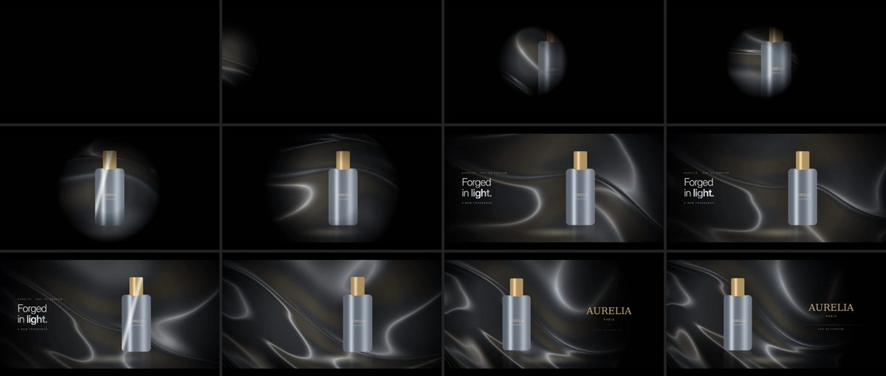

# AURELIA: chrome perfume reveal (16:9 + 9:16)



**Brief:** *"Premium, futuristic advertisement with chrome materials, dramatic lighting and smooth cinematic camera movement."*
10 s at 30 fps. Both aspect ratios come from the same `index.html`, which re-composes the shot per ratio instead of stretching it.

**Inputs:** a synthetic product photo and logo made for this test. AURELIA is not a real brand.

**What the skill did:**
- Cut the bottle out of its white background and cropped the leftover shadow.
- Ran a real library search over MCP.
- Built the film from three mechanics:
  - a liquid-chrome WebGL backdrop (`webgl-interactive-gradient`, adapted-source)
  - a light pool that reveals things in darkness (`guiding-light`)
  - masked line reveals (`permianworld-landing-page-animation`)

**Beats:**
- 0 to 1.8 s: the light finds the metal.
- 1.4 to 4 s: the bottle rises in the light pool with a specular sweep.
- 3.6 to 6.6 s: the darkness opens and the headline comes in.
- 6.4 to 7.8 s: a second sheen.
- 7.5 to 10 s: logo end card.

QA caught and fixed a stacking-context bug that dimmed the headline in 9:16.

**Renders:** [`aurelia-16x9.mp4`](renders/aurelia-16x9.mp4) · [`aurelia-9x16.mp4`](renders/aurelia-9x16.mp4). Credits: [`CREDITS.md`](CREDITS.md).

**Re-render:**
```
bash ../../plugins/motion-design-director/scripts/new_project.sh . --three   # vendors gsap + three, keeps index.html
node ../../plugins/motion-design-director/scripts/render_video.mjs --project . --out out/a.mp4
```
