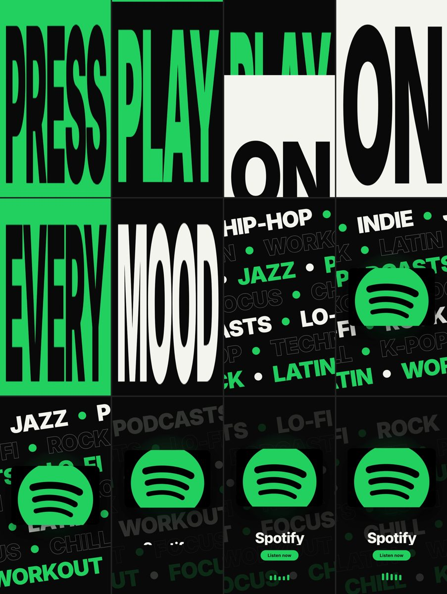

# Spotify: kinetic type spec ad (9:16, 10 s)

> **Unofficial spec work.** This is a portfolio exercise made to demonstrate the skill. It is not affiliated with, sponsored by or endorsed by Spotify. Spotify and the Spotify logo are trademarks of Spotify AB. The logo file is **not** included in this repository, and the copy ("Press play on every mood", "Listen now") was written for this exercise.

**Brief:** *"Create a professional ad video for Spotify."* After intake: energetic and kinetic, 9:16, for a portfolio.

**What the skill did:** asked for the missing assets, then inspected the supplied logo. The image was cropped at the top and bottom, so it was shown whole inside a rounded card instead of being redrawn. The palette was sampled from the logo (#23D061). It searched the library over MCP and picked these mechanics, as original code:
- `phive-text-scroll-animation`: giant words that scaleY-stretch to fill a full-screen band, then collapse into the next one
- `stacked-alternating-marquees`: dense genre rows running in alternating directions

Everything is cut to a 120 BPM grid.

**Beats:**
- 0 to 5 s: PRESS / PLAY / ON / EVERY / MOOD, 2 beats per word.
- 5 to 7.5 s: the marquees and the logo card land, and the card pulses on the beat.
- 7.5 to 10 s: wordmark, "Listen now" and an equalizer.

**Render:** [`spotify-9x16.mp4`](renders/spotify-9x16.mp4). Credits: [`CREDITS.md`](CREDITS.md).

**To re-render,** add your own logo file at `assets/logo-src.webp`. The logo is not shipped in this repo.
